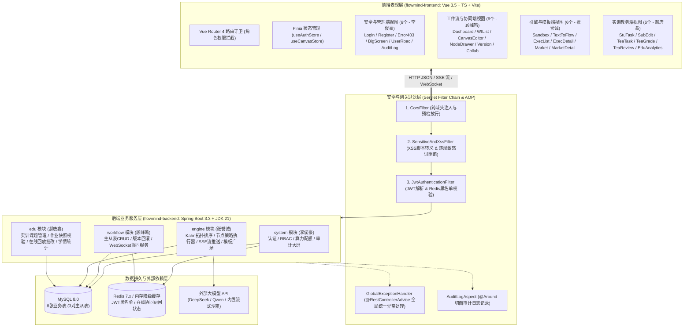
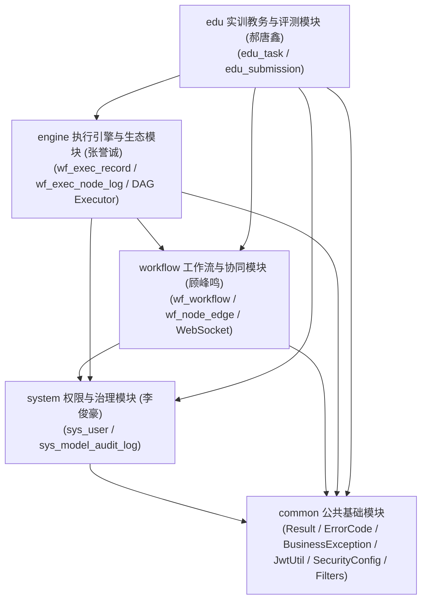

# FlowMind 系统总体架构设计文档 (ARCHITECTURE)

## 1. 架构设计原则

1. **高内聚低耦合，按 4 人团队物理隔离模块**：后端按包路径拆分为 `common`（公共基础层）、`system`（李俊豪）、`workflow`（顾峰鸣）、`engine`（张誉诚）、`edu`（郝唐鑫）五大模块；前端按 `views/` 与 `api/` 拆分为独立目录，彻底消除多人并行开发时的 Git 合并冲突。
2. **务实可靠，拒绝过度设计**：
   - 不引入 Kafka、Zookeeper、Nacos 等重量级分布式中间件，单机通过 `Spring Boot 3.3 + MySQL 8.0 + Redis` 即可一键启动。
   - **Redis 双模容错机制**：封装 `TokenCacheService` 接口，默认使用 `StringRedisTemplate`；当本地开发机器未启动 Redis 时，通过 `@ConditionalOnProperty` 自动回退至基于 `ConcurrentHashMap` 的内存缓存实现，保证任何组员或 Codex 在纯 MySQL 环境下也能 100% 启动并跑通全部单元测试。
   - **AI 模型双模容错机制**：当管理员配置了真实 DeepSeek / Qwen API Key 时发起真实 HTTP SSE 流式调用；当未配置 Key 或选用 `MOCK_LOCAL` 通道时，自动启用内置确定性智能流式模拟器（按词元间隔 30ms 推送 SSE 流），保证离线答辩与自动化测试 100% 稳定通过。

---

## 2. 系统总体技术架构图

---

## 3. 后端分层架构与模块依赖关系

### 3.1 标准四层架构职责规范
每个业务模块（`system`、`workflow`、`engine`、`edu`）内部严格遵循四层结构，禁止跨层调用（如 Controller 严禁直接注入 Mapper）：

1. **Controller 层 (`controller/`)**：
   - 仅负责路由映射、接收 `@Valid` 校验后的请求 DTO、调用 `@PreAuthorize` 校验角色权限、从 `SecurityContextHolder` 获取当前登录用户 ID、调用 Service 层并包装为统一 `Result<T>` 返回。
2. **Service 层 (`service/` & `service/impl/`)**：
   - 承载核心业务逻辑、事务边界控制（`@Transactional(rollbackFor = Exception.class)`）、主从表级联保存与删除、复杂业务规则校验（如算力余额检查、必含节点校验），抛出 `BusinessException(ErrorCode)`。
3. **Mapper / DAO 层 (`mapper/`)**：
   - 继承 MyBatis-Plus `BaseMapper<Entity>`，负责单表 CRUD 与基于 `LambdaQueryWrapper` 的多条件动态分页查询，或通过注解/XML 执行多表聚合统计 SQL。
4. **模型层 (`entity/`, `dto/`, `vo/`)**：
   - `Entity`：与数据库 8 张表一一严格映射，使用 `@TableName`、`@TableId`、`@TableField`。
   - `DTO`：前端传入的请求体或查询条件封装（带 Jakarta Validation 注解 `@NotBlank`, `@NotNull`, `@Min`, `@Size`）。
   - `VO`：返回给前端的视图对象（隐藏敏感字段如 `passwordHash`，组装主从表嵌套列表）。

### 3.2 模块间依赖关系图

- **解耦约定**：
  - `engine` 模块需读取 `workflow` 模块的画布主从表数据，并调用 `system` 模块的 `SysUserService.deductTokenQuota(userId, tokens)` 扣减算力。
  - `edu` 模块在学生提交作业时调用 `workflow` 模块的 `WorkflowService.getWorkflowDetail(workflowId)` 生成 `canvas_snapshot_json` 快照；在教师在线试跑时复用 `engine` 模块的沙箱运行接口。

---

## 4. 核心技术机制架构设计

### 4.1 过滤器链（Filter Chain）与认证流转设计
请求进入后端的严格执行顺序如下：
1. **`CorsFilter` (Order = 1)**：设置 `Access-Control-Allow-Origin`、`Access-Control-Allow-Headers` (`Authorization, Content-Type`)，对 `OPTIONS` 预检请求直接返回 200。
2. **`SensitiveAndXssFilter` (Order = 2)**：使用 `ContentCachingRequestWrapper` 包装 `application/json` 请求体，执行两项检查：
   - XSS 恶意脚本标签检测（如 `<script>`、`javascript:`）；
   - 违规敏感词匹配（读取 `SysModelConfigService` 维护的敏感词集合，默认内置 `["drop table", "delete from sys_user", "rm -rf", "赌博", "诈骗"]`）。
   - 若命中则直接通过 `HttpServletResponse` 输出 HTTP 400 及标准 JSON `{ "code": 40009, "message": "请求包含违规敏感词或恶意脚本，已被安全过滤器拦截" }`，并异步写入 `sys_model_audit_log` (`action_type = 'SENSITIVE_BLOCK'`)。
3. **`JwtAuthenticationFilter` (Order = 3)**：
   - 白名单路径（`/api/v1/auth/login`, `/api/v1/auth/register`, `/api/v1/market/templates/**` 只读列表, `/ws/**`, `/doc.html`, `/v3/api-docs/**`）直接放行。
   - 提取 `Authorization: Bearer <token>`，校验签名与过期时间。
   - 查询 `TokenCacheService.isBlacklisted(jti)`：若在黑名单中（已执行安全退出），返回 HTTP 401 (`code: 40102`, `"登录凭证已失效，请重新登录"`)。
   - 构造 `LoginUser` 注入 `SecurityContextHolder`，供后续 `@PreAuthorize("hasRole('ADMIN')")` 等注解鉴权。

### 4.2 WebSocket + Yjs 多人实时同屏协同架构（顾峰鸣负责）
- **端点地址**：`ws://localhost:8080/ws/collab/{workflowId}?token={jwt}`
- **房间管理**：后端 `CollabWebSocketHandler` 维护 `ConcurrentHashMap<Long, Map<Long, WebSocketSession>>`，以 `workflowId` 为房间号（Room），以 `userId` 为成员键。
- **每位成员专属光标颜色分配**：根据 `userId % 6` 自动分配高对比度科研配色（`#3B82F6` 蓝、`#10B981` 绿、`#F59E0B` 橙、`#EC4899` 粉、`#8B5CF6` 紫、`#EF4444` 红）。
- **消息协议（JSON 帧）**：
  - `PRESENCE_JOIN` / `PRESENCE_LEAVE`：成员进出画布房间广播当前在线协作者列表。
  - `CURSOR_MOVE`：广播成员鼠标在画布坐标系中的 `{ x, y, userId, realName, color }`（前端节流 40ms 发送一次）。
  - `GRAPH_DELTA`：当成员拖拽移动节点、修改节点配置或增删连线时，广播变更增量（或 Yjs 更新向量），同房间其余客户端实时应用更新，实现毫秒级同屏协作。

### 4.3 DAG 拓扑执行与 SSE 流式推送架构（张誉诚负责）
- **通信协议**：采用基于 `SseEmitter`（超时时间 120,000ms）的标准 SSE 协议，接口为 `POST /api/v1/engine/execute/stream`（配合 `@microsoft/fetch-event-source` 支持携带 `Authorization` 请求头和 JSON Body）。
- **推送事件类型（Event Types）**：
  1. `event: WORKFLOW_START` $\rightarrow$ 返回 `{ execNo, execRecordId, totalSteps }`
  2. `event: NODE_START` $\rightarrow$ 返回 `{ nodeKey, nodeName, nodeType, stepOrder }`（前端画布将该节点边框设为脉冲流光蓝色）
  3. `event: NODE_CHUNK` $\rightarrow$ 返回 `{ nodeKey, deltaText }`（前端调试抽屉以打字机效果实时追加文本）
  4. `event: NODE_FINISH` $\rightarrow$ 返回 `{ nodeKey, stepStatus, costMs, tokenCost, output }`（前端画布将该节点设为成功绿色）
  5. `event: WORKFLOW_FINISH` $\rightarrow$ 返回 `{ execRecordId, execStatus, totalTokens, durationMs, finalOutput }`
  6. `event: WORKFLOW_ERROR` $\rightarrow$ 返回 `{ nodeKey, errorMessage }`（前端画布将该节点设为告警红色）
