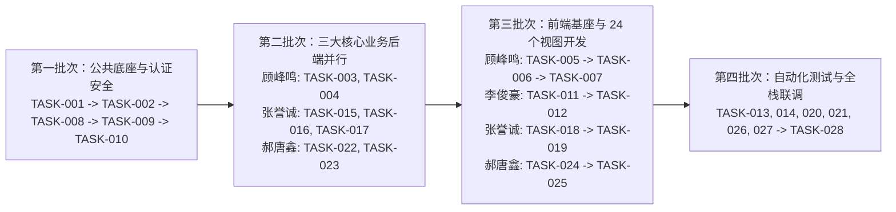

# OpenAI Codex 专属开发执行指南 (CODEX_GUIDE)

## 1. 面向 Codex 的核心工作守则

欢迎进入 **FlowMind（智流）** 项目仓库。作为本项目的核心编程智能体，你在执行任何编码任务前必须严格遵守以下工作流：

1. **先读文档，再写代码**：
   - 每次会话开始时，先阅读根目录 `AGENTS.md`，再按需阅读 `docs/DATABASE.md`、`docs/API.md`、`docs/PROJECT_STRUCTURE.md`、`docs/BUSINESS_LOGIC.md` 和 `docs/DEVELOPMENT_TASKS.md`。
2. **严格遵守既定命名与契约**：
   - 数据库表名（8张）与字段名必须与 `docs/DATABASE.md` 完全一致。
   - REST 接口路径、HTTP 方法、请求参数、返回 JSON 字段与错误码必须与 `docs/API.md` 完全一致。
   - 后端包结构与前端 24 个视图文件路径必须与 `docs/PROJECT_STRUCTURE.md` 完全一致。
3. **真实可运行实现，严禁空壳代码**：
   - 严禁编写 `// TODO`、空方法或直接返回硬编码假列表的 Controller。
   - 所有 CRUD 与多条件查询必须真实通过 MyBatis-Plus `LambdaQueryWrapper` 查询数据库。
   - Redis 缓存与大模型调用必须实现 `docs/ARCHITECTURE.md` 规定的**双模容错机制**（当未启动外部 Redis 或未配置付费大模型 API Key 时，自动平滑降级到内存黑名单缓存与内置智能流式沙箱引擎，确保任何环境下 100% 可编译、可运行、可通过全部自动化测试）。
4. **严守团队分工边界**：
   - 当被指派执行某个 `TASK-xxx` 时，只创建或修改该任务声明负责的文件，不要破坏或重写其他成员负责的子系统代码。

---

## 2. 推荐的全局开发执行顺序

为确保模块依赖顺畅，建议按以下 **4 个批次（Waves）** 依次推进开发：



---

## 3. 可直接复制使用的 Codex 开发提示词模板 (Prompt Templates)

团队成员（顾峰鸣、张誉诚、郝唐鑫、李俊豪）在调用 Codex 时，可直接复制以下对应模板发送给 Codex：

### 3.1 通用单任务执行模板（适用于任意 `TASK-xxx`）
```text
请先阅读项目根目录的 AGENTS.md，以及 docs/DEVELOPMENT_TASKS.md、docs/DATABASE.md、docs/API.md 和 docs/PROJECT_STRUCTURE.md。
现在请你完整实现 【TASK-001 和 TASK-002】（请替换为你要执行的任务编号）。

执行要求：
1. 严格遵循既定的包名、表结构、实体字段名和 API 接口规范，不要擅自更改设计。
2. 只创建和修改本任务负责的文件，绝不使用空函数、TODO 或硬编码假数据冒充业务逻辑。
3. 完成后请运行编译或单元测试验证代码正确性。
4. 最后向我汇报：新增/修改的文件列表、核心实现逻辑说明、测试运行结果以及发现的任何潜在问题。
```

### 3.2 组长【顾峰鸣】专属一键开发提示词（架构底座 + 工作流主从表 + 画布协同）
```text
我是项目组长顾峰鸣。请先阅读根目录 AGENTS.md 以及 docs/ 下的 DATABASE.md、API.md、BUSINESS_LOGIC.md、DEVELOPMENT_TASKS.md。
请按顺序帮我完成我负责的后端与前端任务：
1. 后端公共底座与工作流协同模块（TASK-001、TASK-002、TASK-003、TASK-004）：
   - 生成 sql/init_flowmind.sql 及 flowmind-backend Maven 工程骨架；
   - 实现 Result、PageResult、ErrorCode、BusinessException、GlobalExceptionHandler、CorsFilter、WebSocketConfig；
   - 实现 wf_workflow（主表）与 wf_node_edge（从表）的实体、Mapper、多条件组合分页查询、画布主从事务保存、版本快照回滚及 CollabWebSocketHandler 多人实时光标协同服务。
2. 前端工程基座与工作流视图（TASK-005、TASK-006、TASK-007）：
   - 搭建 flowmind-frontend (Vue 3 + TS + Vite + Pinia + Vue Router + Element Plus + Vue Flow + ECharts)；
   - 实现 VIEW-04 (DashboardView.vue) 至 VIEW-09 (CollabManageModal.vue) 共 6 个视图组件及多人实时彩色光标同步逻辑。
完成后执行 mvn compile 和 npm run build 验证通过，并汇报结果。
```

### 3.3 组员【李俊豪】专属一键开发提示词（认证安全 + RBAC + 算力与监控大屏）
```text
我是组员李俊豪（GitHub: lijunhao）。请阅读根目录 AGENTS.md 以及 docs/ 下的 DATABASE.md、API.md、BUSINESS_LOGIC.md、DEVELOPMENT_TASKS.md。
请完成我负责的权限安全与管理员大屏子系统（TASK-008、TASK-009、TASK-010、TASK-011、TASK-012、TASK-013）：
1. 后端 system 模块与安全组件：
   - 实现 sys_user 与 sys_model_audit_log 实体和 Mapper；
   - 实现 SecurityConfig (BCryptPasswordEncoder)、JwtUtil、TokenCacheService（支持 Redis 与内存双模黑名单）、JwtAuthenticationFilter、SensitiveAndXssFilter（拦截违规敏感词并写审计日志）；
   - 实现 /api/v1/auth/**（注册、登录、安全退出、当前用户）与 /api/v1/admin/**（用户多条件查询、角色与算力配额管理、模型通道配置、审计日志多条件查询、大屏统计聚合接口）。
2. 前端 6 个视图组件：
   - 实现 VIEW-01 (LoginView.vue)、VIEW-02 (RegisterView.vue)、VIEW-03 (Error403View.vue)、VIEW-22 (BigScreenMonitorView.vue)、VIEW-23 (UserAndRbacView.vue)、VIEW-24 (ModelAndAuditLogView.vue)。
3. 编写并运行 AuthAndSecurityIntegrationTest 确保全部通过。
```

### 3.4 组员【张誉诚】专属一键开发提示词（AI DAG 引擎 + SSE 沙箱 + 模板广场）
```text
我是组员张誉诚。请阅读根目录 AGENTS.md 以及 docs/ 下的 DATABASE.md、API.md、BUSINESS_LOGIC.md、DEVELOPMENT_TASKS.md。
请完成我负责的 AI 执行引擎与模板生态子系统（TASK-015、TASK-016、TASK-017、TASK-018、TASK-019、TASK-020）：
1. 后端 engine 模块：
   - 实现 wf_exec_record（主表）与 wf_exec_node_log（从表）实体与 Mapper；
   - 实现 DagTopologicalSorter（Kahn 拓扑排序与环路检测）、LlmClientAdapter（真实 DeepSeek/Qwen API 与本地智能流式沙箱双模切换）、WorkflowDagExecutor（支持 6 类节点执行、条件分支剪枝、变量插值、算力扣减与 SSE 流式事件推送）；
   - 实现 Text-to-Flow 一句话生成工作流接口、运行记录主从多条件查询接口，以及模板广场（/api/v1/market/templates/**）多条件检索、点赞与一键 Fork 克隆接口。
2. 前端 6 个视图组件：
   - 实现 VIEW-10 (SandboxRunnerView.vue) 至 VIEW-15 (TemplateDetailView.vue) 共 6 个视图组件。
3. 编写并运行 WorkflowEngineAndMarketTest 确保全部通过。
```

### 3.5 组员【郝唐鑫】专属一键开发提示词（实训教务 + 快照评测 + 学情统计）
```text
我是组员郝唐鑫。请阅读根目录 AGENTS.md 以及 docs/ 下的 DATABASE.md、API.md、BUSINESS_LOGIC.md、DEVELOPMENT_TASKS.md。
请完成我负责的高校实训教务管理与在线评测分析子系统（TASK-022、TASK-023、TASK-024、TASK-025、TASK-026）：
1. 后端 edu 模块：
   - 实现 edu_task（主表）与 edu_submission（从表）实体与 Mapper；
   - 实现教师端实训课题 CRUD、学生端提交作业（自动固化工作流画布为 canvas_snapshot_json、校验 required_nodes_json 必含节点规则、判断逾期状态）；
   - 实现教师端作业多条件分页查询、在线批改评分评语接口，以及 /api/v1/edu/analytics 班级学情 ECharts 统计报表接口（成绩分段、五维雷达、提交趋势、高频报错节点分布）。
2. 前端 6 个视图组件：
   - 实现 VIEW-16 (StudentTaskListView.vue) 至 VIEW-21 (EduAnalyticsView.vue) 共 6 个视图组件。
3. 编写并运行 EduTrainingAndAnalyticsTest 确保全部通过。
```

---

## 4. 常见问题与排错指南

1. **本地测试时没有启动 MySQL 或 Redis 怎么办？**
   - `application-test.yml` 配置了 H2 MySQL 兼容模式（`jdbc:h2:mem:flowmind_db;MODE=MySQL`）自动执行 `sql/init_flowmind.sql`，且 `TokenCacheService` 默认支持无 Redis 自动回退至 `ConcurrentHashMap`，因此 `mvn test` 在任何无外部服务的纯净环境中都能直接跑通。
2. **如何切换真实大模型 API？**
   - 使用管理员账号 `admin`（密码 `123456`）登录系统，进入 `ModelAndAuditLogView.vue` 页面填入 DeepSeek 或通义千问 API Key 并保存，无需重启后端服务即可即时生效。
