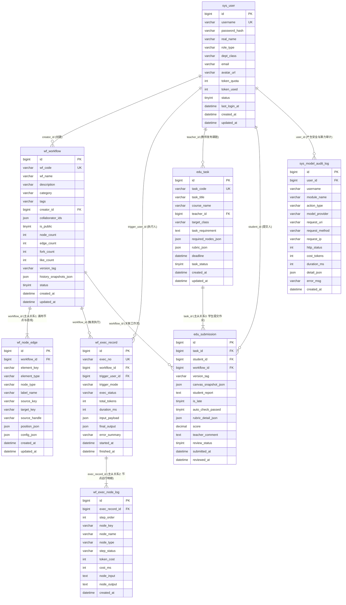

# FlowMind 数据库详细设计文档 (DATABASE)

## 1. 数据库设计总览

- **数据库管理系统**：MySQL 8.0+
- **数据库名称**：`flowmind_db`
- **字符集与排序规则**：`utf8mb4` / `utf8mb4_unicode_ci`
- **存储引擎**：`InnoDB`（支持事务、行级锁与外键级联约束）
- **表规模与主从关系达标核验**：
  - 共设计 **8 张核心业务表**（远超实训要求的 $\ge 6$ 张表）。
  - 包含 **3 对严格的主从表（Master-Detail）关系**（远超实训要求的 $\ge 2$ 对主从表）：
    1. **主从关系一（工作流定义）**：`wf_workflow`（主表） $1 : N$ `wf_node_edge`（从表，外键 `workflow_id`）
    2. **主从关系二（工作流运行追踪）**：`wf_exec_record`（主表） $1 : N$ `wf_exec_node_log`（从表，外键 `exec_record_id`）
    3. **主从关系三（实训课题与作业评测）**：`edu_task`（主表） $1 : N$ `edu_submission`（从表，外键 `task_id`）
  - **基础与安全治理支撑表（2 张）**：`sys_user`、`sys_model_audit_log`。

---

## 2. 全局实体关系图 (ER Diagram)



---

## 3. 各数据表字典详细定义

### 3.1 表 1：`sys_user`（系统用户与算力账户表 — 负责人：李俊豪）
| 字段名 | 类型 | 必填 | 默认值 | 说明 |
| :--- | :--- | :---: | :--- | :--- |
| `id` | `BIGINT` | 是 | `AUTO_INCREMENT` | 主键 ID |
| `username` | `VARCHAR(64)` | 是 | 无 | 登录账号（学号/工号/管理员账号），唯一索引 `uk_username` |
| `password_hash` | `VARCHAR(128)` | 是 | 无 | BCrypt 强哈希加密后的密码密文 |
| `real_name` | `VARCHAR(64)` | 是 | 无 | 真实姓名 |
| `role_type` | `VARCHAR(20)` | 是 | `'STUDENT'` | 角色枚举：`ADMIN` / `TEACHER` / `STUDENT` |
| `dept_class` | `VARCHAR(100)` | 否 | `NULL` | 所属院系或行政班级（如 `计科1班`） |
| `email` | `VARCHAR(128)` | 否 | `NULL` | 电子邮箱 |
| `avatar_url` | `VARCHAR(255)` | 否 | `NULL` | 头像地址 |
| `token_quota` | `INT` | 是 | `50000` | 剩余可用大模型 Token 算力额度 |
| `token_used` | `INT` | 是 | `0` | 累计已消耗 Token 算力 |
| `status` | `TINYINT` | 是 | `1` | 状态：`1`-正常启用，`0`-封禁禁用 |
| `last_login_at` | `DATETIME` | 否 | `NULL` | 最后登录时间 |
| `created_at` | `DATETIME` | 是 | `CURRENT_TIMESTAMP` | 创建时间 |
| `updated_at` | `DATETIME` | 是 | `CURRENT_TIMESTAMP` | 更新时间 |

### 3.2 表 2：`sys_model_audit_log`（模型配置与安全审计日志表 — 负责人：李俊豪）
| 字段名 | 类型 | 必填 | 默认值 | 说明 |
| :--- | :--- | :---: | :--- | :--- |
| `id` | `BIGINT` | 是 | `AUTO_INCREMENT` | 主键 ID |
| `user_id` | `BIGINT` | 否 | `NULL` | 操作人用户 ID（外键关联 `sys_user.id`） |
| `username` | `VARCHAR(64)` | 否 | `NULL` | 操作人账号快照 |
| `module_name` | `VARCHAR(50)` | 是 | 无 | 模块名：`AUTH` / `WORKFLOW` / `ENGINE` / `EDU` / `ADMIN` |
| `action_type` | `VARCHAR(50)` | 是 | 无 | 动作类型：`LOGIN` / `LOGOUT` / `EXEC_AI` / `SENSITIVE_BLOCK` / `QUOTA_CHANGE` / `MODEL_CONFIG` / `EXCEPTION` |
| `model_provider`| `VARCHAR(50)` | 否 | `NULL` | 模型通道：`DEEPSEEK` / `QWEN` / `MOCK_LOCAL` |
| `request_uri` | `VARCHAR(255)` | 否 | `NULL` | 请求 URI |
| `request_method`| `VARCHAR(16)` | 否 | `NULL` | HTTP 方法（`GET`/`POST`/`PUT`/`DELETE`） |
| `request_ip` | `VARCHAR(64)` | 否 | `NULL` | 客户端 IP 地址 |
| `http_status` | `INT` | 是 | `200` | HTTP 响应状态码 |
| `cost_tokens` | `INT` | 是 | `0` | 本次消耗 Token 数 |
| `duration_ms` | `INT` | 是 | `0` | 请求耗时（毫秒） |
| `detail_json` | `JSON` | 否 | `NULL` | 扩展详情 JSON（如模型通道配置参数或操作载荷摘要） |
| `error_msg` | `VARCHAR(1000)`| 否 | `NULL` | 异常信息或敏感词拦截详情 |
| `created_at` | `DATETIME` | 是 | `CURRENT_TIMESTAMP` | 记录时间 |

### 3.3 表 3：`wf_workflow`（AI 工作流主表 — 【主从对 1：主表】 — 负责人：顾峰鸣）
| 字段名 | 类型 | 必填 | 默认值 | 说明 |
| :--- | :--- | :---: | :--- | :--- |
| `id` | `BIGINT` | 是 | `AUTO_INCREMENT` | 工作流主键 ID |
| `wf_code` | `VARCHAR(64)` | 是 | 无 | 工作流唯一编码（如 `WF-20261030-001`），唯一索引 |
| `wf_name` | `VARCHAR(128)` | 是 | 无 | 工作流名称 |
| `description` | `VARCHAR(1000)`| 否 | `NULL` | 工作流功能描述 |
| `category` | `VARCHAR(50)` | 是 | `'CODE_ASSIST'` | 分类：`CODE_ASSIST` / `DATA_ANALYSIS` / `TEXT_GEN` / `KNOWLEDGE_QA` / `OTHER` |
| `tags` | `VARCHAR(255)` | 否 | `NULL` | 逗号分隔标签（如 `Java,代码审查,实训`） |
| `creator_id` | `BIGINT` | 是 | 无 | 创建者用户 ID（外键关联 `sys_user.id`） |
| `collaborator_ids`| `JSON` | 否 | `NULL` | 协作成员用户 ID 数组（如 `[2, 4, 5]`） |
| `is_public` | `TINYINT` | 是 | `0` | 是否公开至模板广场：`0`-私有，`1`-公开 |
| `node_count` | `INT` | 是 | `0` | 节点总数（冗余统计字段，加速多条件区间筛选） |
| `edge_count` | `INT` | 是 | `0` | 连线总数 |
| `fork_count` | `INT` | 是 | `0` | 被 Fork 克隆次数 |
| `like_count` | `INT` | 是 | `0` | 点赞次数 |
| `version_tag` | `VARCHAR(32)` | 是 | `'v1.0.0'` | 当前版本号 |
| `history_snapshots_json` | `JSON` | 否 | `NULL` | 历史版本快照数组 `[{versionTag, savedAt, savedBy, nodes, edges}]` |
| `status` | `TINYINT` | 是 | `1` | 状态：`1`-正常，`0`-已删除 |
| `created_at` | `DATETIME` | 是 | `CURRENT_TIMESTAMP` | 创建时间 |
| `updated_at` | `DATETIME` | 是 | `CURRENT_TIMESTAMP` | 更新时间 |

### 3.4 表 4：`wf_node_edge`（工作流节点与连线明细从表 — 【主从对 1：从表】 — 负责人：顾峰鸣）
| 字段名 | 类型 | 必填 | 默认值 | 说明 |
| :--- | :--- | :---: | :--- | :--- |
| `id` | `BIGINT` | 是 | `AUTO_INCREMENT` | 从表主键 ID |
| `workflow_id` | `BIGINT` | 是 | 无 | 所属工作流 ID（外键关联 `wf_workflow.id` ON DELETE CASCADE） |
| `element_key` | `VARCHAR(64)` | 是 | 无 | 画布内元素唯一 Key（如 `node_input_1`, `edge_1_2`） |
| `element_type` | `VARCHAR(16)` | 是 | 无 | 元素类型：`NODE`（节点）或 `EDGE`（连线） |
| `node_type` | `VARCHAR(32)` | 否 | `NULL` | 节点类型：`INPUT` / `LLM` / `KNOWLEDGE` / `CODE` / `CONDITION` / `OUTPUT` |
| `label_name` | `VARCHAR(128)` | 否 | `NULL` | 节点标题或连线显示文本 |
| `source_key` | `VARCHAR(64)` | 否 | `NULL` | 连线起点节点 `element_key`（仅 `EDGE` 有效） |
| `target_key` | `VARCHAR(64)` | 否 | `NULL` | 连线终点节点 `element_key`（仅 `EDGE` 有效） |
| `source_handle` | `VARCHAR(64)` | 否 | `'default'` | 起点输出锚点（`CONDITION` 节点为 `'true'` 或 `'false'`） |
| `position_json` | `JSON` | 否 | `NULL` | 节点画布坐标 `{"x": 150, "y": 220}` |
| `config_json` | `JSON` | 否 | `NULL` | 节点业务配置 JSON（Prompt模板、温度、知识库规则、脚本代码等） |
| `created_at` | `DATETIME` | 是 | `CURRENT_TIMESTAMP` | 创建时间 |
| `updated_at` | `DATETIME` | 是 | `CURRENT_TIMESTAMP` | 更新时间 |

### 3.5 表 5：`wf_exec_record`（工作流运行记录主表 — 【主从对 2：主表】 — 负责人：张誉诚）
| 字段名 | 类型 | 必填 | 默认值 | 说明 |
| :--- | :--- | :---: | :--- | :--- |
| `id` | `BIGINT` | 是 | `AUTO_INCREMENT` | 运行记录主表 ID |
| `exec_no` | `VARCHAR(64)` | 是 | 无 | 运行流水号（唯一索引 `uk_exec_no`） |
| `workflow_id` | `BIGINT` | 是 | 无 | 关联工作流 ID（外键关联 `wf_workflow.id` ON DELETE CASCADE） |
| `trigger_user_id`| `BIGINT` | 是 | 无 | 触发执行的用户 ID（外键关联 `sys_user.id`） |
| `trigger_mode` | `VARCHAR(32)` | 是 | `'SANDBOX'` | 触发模式：`SANDBOX` / `TEACHER_REVIEW` / `TEMPLATE_TEST` |
| `exec_status` | `VARCHAR(20)` | 是 | `'RUNNING'` | 运行状态：`RUNNING` / `SUCCESS` / `FAILED` |
| `total_tokens` | `INT` | 是 | `0` | 本次运行总消耗 Token 数 |
| `duration_ms` | `INT` | 是 | `0` | 本次运行总耗时（毫秒） |
| `input_payload` | `JSON` | 否 | `NULL` | 初始输入参数 JSON |
| `final_output` | `JSON` | 否 | `NULL` | 最终输出结果 JSON |
| `error_summary` | `VARCHAR(500)` | 否 | `NULL` | 异常摘要 |
| `started_at` | `DATETIME` | 是 | `CURRENT_TIMESTAMP` | 开始时间 |
| `finished_at` | `DATETIME` | 否 | `NULL` | 结束时间 |

### 3.6 表 6：`wf_exec_node_log`（节点执行日志明细从表 — 【主从对 2：从表】 — 负责人：张誉诚）
| 字段名 | 类型 | 必填 | 默认值 | 说明 |
| :--- | :--- | :---: | :--- | :--- |
| `id` | `BIGINT` | 是 | `AUTO_INCREMENT` | 节点日志从表 ID |
| `exec_record_id`| `BIGINT` | 是 | 无 | 关联运行主表 ID（外键 `wf_exec_record.id` ON DELETE CASCADE） |
| `step_order` | `INT` | 是 | `1` | 节点执行顺序号（1, 2, 3...） |
| `node_key` | `VARCHAR(64)` | 是 | 无 | 对应画布节点 `element_key` |
| `node_name` | `VARCHAR(128)` | 是 | 无 | 节点名称快照 |
| `node_type` | `VARCHAR(32)` | 是 | 无 | 节点类型快照 |
| `step_status` | `VARCHAR(20)` | 是 | `'SUCCESS'` | 节点状态：`RUNNING` / `SUCCESS` / `ERROR` / `SKIPPED` |
| `token_cost` | `INT` | 是 | `0` | 该节点消耗 Token 数 |
| `cost_ms` | `INT` | 是 | `0` | 该节点执行耗时（毫秒） |
| `node_input` | `TEXT` | 否 | `NULL` | 节点变量替换后的实际输入内容 |
| `node_output` | `TEXT` | 否 | `NULL` | 节点实际输出内容或错误堆栈 |
| `created_at` | `DATETIME` | 是 | `CURRENT_TIMESTAMP` | 记录时间 |

### 3.7 表 7：`edu_task`（实训课程任务主表 — 【主从对 3：主表】 — 负责人：郝唐鑫）
| 字段名 | 类型 | 必填 | 默认值 | 说明 |
| :--- | :--- | :---: | :--- | :--- |
| `id` | `BIGINT` | 是 | `AUTO_INCREMENT` | 实训任务主表 ID |
| `task_code` | `VARCHAR(64)` | 是 | 无 | 课题编号（唯一索引 `uk_task_code`） |
| `task_title` | `VARCHAR(128)` | 是 | 无 | 实训课题标题 |
| `course_name` | `VARCHAR(100)` | 是 | 无 | 所属课程名称 |
| `teacher_id` | `BIGINT` | 是 | 无 | 发布教师 ID（外键关联 `sys_user.id`） |
| `target_class` | `VARCHAR(100)` | 是 | 无 | 面向行政班级 |
| `task_requirement`| `TEXT` | 是 | 无 | 实训课题详细任务书要求 |
| `required_nodes_json`| `JSON` | 是 | 无 | 必含节点校验规则 `{"minNodes":4,"mustInclude":["INPUT","LLM","OUTPUT"]}` |
| `rubric_json` | `JSON` | 否 | `NULL` | 评分细则权重数组 `[{"dimension":"拓扑合理性","weight":30},...]` |
| `deadline` | `DATETIME` | 是 | 无 | 提交截止时间 |
| `task_status` | `TINYINT` | 是 | `1` | 状态：`1`-进行中，`2`-已截止，`0`-已归档 |
| `created_at` | `DATETIME` | 是 | `CURRENT_TIMESTAMP` | 创建时间 |
| `updated_at` | `DATETIME` | 是 | `CURRENT_TIMESTAMP` | 更新时间 |

### 3.8 表 8：`edu_submission`（学生实训作业提交从表 — 【主从对 3：从表】 — 负责人：郝唐鑫）
| 字段名 | 类型 | 必填 | 默认值 | 说明 |
| :--- | :--- | :---: | :--- | :--- |
| `id` | `BIGINT` | 是 | `AUTO_INCREMENT` | 作业提交从表 ID |
| `task_id` | `BIGINT` | 是 | 无 | 关联实训任务主表 ID（外键 `edu_task.id` ON DELETE CASCADE） |
| `student_id` | `BIGINT` | 是 | 无 | 提交学生 ID（外键 `sys_user.id`） |
| `workflow_id` | `BIGINT` | 是 | 无 | 关联工作流 ID（外键 `wf_workflow.id`） |
| `version_tag` | `VARCHAR(32)` | 是 | `'v1.0.0'` | 提交时的工作流版本号 |
| `canvas_snapshot_json`| `JSON` | 是 | 无 | 提交时刻的完整画布节点与连线 JSON 快照 |
| `student_report`| `TEXT` | 是 | 无 | 学生实验设计思路与总结报告 |
| `is_late` | `TINYINT` | 是 | `0` | 是否逾期提交：`0`-按时，`1`-逾期 |
| `auto_check_passed`| `TINYINT` | 是 | `1` | 必含节点规则自动预检结果：`1`-通过，`0`-未通过 |
| `rubric_detail_json`| `JSON` | 否 | `NULL` | 教师分项评分明细 JSON |
| `score` | `DECIMAL(5,2)` | 否 | `NULL` | 教师评定总分（`0.00 ~ 100.00`） |
| `teacher_comment`| `TEXT` | 否 | `NULL` | 教师批改评语 |
| `review_status` | `TINYINT` | 是 | `0` | 批改状态：`0`-待批改，`1`-已批改，`2`-打回重做 |
| `submitted_at` | `DATETIME` | 是 | `CURRENT_TIMESTAMP` | 提交时间 |
| `reviewed_at` | `DATETIME` | 否 | `NULL` | 教师批改时间 |

---

## 4. 可直接执行的完整建表与初始数据 SQL (`sql/init_flowmind.sql`)

> **说明**：以下 SQL 可直接在 MySQL 8.0 中一键执行。内置默认测试账号的密码统一为 `123456`（对应标准 BCrypt 哈希值 `$2a$10$N.zmdr9k7uOCQb376NoUnuTJ8iAt6Z5EHsM8lE9lBOsl7iKTVKIUi`）。

```sql
-- =========================================================================
-- FlowMind (智流) 数据库初始化脚本 (MySQL 8.0+)
-- 包含 8 张业务表、3 对严格外键主从表关系及演示初始数据
-- =========================================================================

CREATE DATABASE IF NOT EXISTS `flowmind_db` DEFAULT CHARACTER SET utf8mb4 COLLATE utf8mb4_unicode_ci;
USE `flowmind_db`;

SET NAMES utf8mb4;
SET FOREIGN_KEY_CHECKS = 0;

-- ----------------------------
-- 1. sys_user (系统用户与算力账户表 - 李俊豪负责)
-- ----------------------------
DROP TABLE IF EXISTS `sys_user`;
CREATE TABLE `sys_user` (
  `id` BIGINT NOT NULL AUTO_INCREMENT COMMENT '主键ID',
  `username` VARCHAR(64) NOT NULL COMMENT '登录账号(唯一)',
  `password_hash` VARCHAR(128) NOT NULL COMMENT 'BCrypt加密密码',
  `real_name` VARCHAR(64) NOT NULL COMMENT '真实姓名',
  `role_type` VARCHAR(20) NOT NULL DEFAULT 'STUDENT' COMMENT '角色: ADMIN/TEACHER/STUDENT',
  `dept_class` VARCHAR(100) DEFAULT NULL COMMENT '所属院系或班级',
  `email` VARCHAR(128) DEFAULT NULL COMMENT '电子邮箱',
  `avatar_url` VARCHAR(255) DEFAULT NULL COMMENT '头像地址',
  `token_quota` INT NOT NULL DEFAULT 50000 COMMENT '剩余可用Token算力额度',
  `token_used` INT NOT NULL DEFAULT 0 COMMENT '累计已消耗Token算力',
  `status` TINYINT NOT NULL DEFAULT 1 COMMENT '状态: 1正常 0封禁',
  `last_login_at` DATETIME DEFAULT NULL COMMENT '最后登录时间',
  `created_at` DATETIME NOT NULL DEFAULT CURRENT_TIMESTAMP COMMENT '创建时间',
  `updated_at` DATETIME NOT NULL DEFAULT CURRENT_TIMESTAMP ON UPDATE CURRENT_TIMESTAMP COMMENT '更新时间',
  PRIMARY KEY (`id`),
  UNIQUE KEY `uk_username` (`username`),
  KEY `idx_role_dept` (`role_type`, `dept_class`),
  KEY `idx_status` (`status`)
) ENGINE=InnoDB DEFAULT CHARSET=utf8mb4 COLLATE=utf8mb4_unicode_ci COMMENT='系统用户与算力账户表';

-- ----------------------------
-- 2. sys_model_audit_log (AI模型通道配置与安全审计日志表 - 李俊豪负责)
-- ----------------------------
DROP TABLE IF EXISTS `sys_model_audit_log`;
CREATE TABLE `sys_model_audit_log` (
  `id` BIGINT NOT NULL AUTO_INCREMENT COMMENT '主键ID',
  `user_id` BIGINT DEFAULT NULL COMMENT '操作用户ID',
  `username` VARCHAR(64) DEFAULT NULL COMMENT '操作用户名快照',
  `module_name` VARCHAR(50) NOT NULL COMMENT '模块: AUTH/WORKFLOW/ENGINE/EDU/ADMIN',
  `action_type` VARCHAR(50) NOT NULL COMMENT '动作: LOGIN/LOGOUT/EXEC_AI/SENSITIVE_BLOCK/QUOTA_CHANGE/MODEL_CONFIG/EXCEPTION',
  `model_provider` VARCHAR(50) DEFAULT NULL COMMENT '模型通道: DEEPSEEK/QWEN/MOCK_LOCAL',
  `request_uri` VARCHAR(255) DEFAULT NULL COMMENT '请求URI',
  `request_method` VARCHAR(16) DEFAULT NULL COMMENT 'HTTP方法',
  `request_ip` VARCHAR(64) DEFAULT NULL COMMENT '客户端IP',
  `http_status` INT NOT NULL DEFAULT 200 COMMENT 'HTTP状态码',
  `cost_tokens` INT NOT NULL DEFAULT 0 COMMENT '消耗Token数',
  `duration_ms` INT NOT NULL DEFAULT 0 COMMENT '耗时(ms)',
  `detail_json` JSON DEFAULT NULL COMMENT '扩展详情或模型配置JSON',
  `error_msg` VARCHAR(1000) DEFAULT NULL COMMENT '异常或敏感词拦截原因',
  `created_at` DATETIME NOT NULL DEFAULT CURRENT_TIMESTAMP COMMENT '创建时间',
  PRIMARY KEY (`id`),
  KEY `idx_user_action` (`user_id`, `action_type`),
  KEY `idx_module_status` (`module_name`, `http_status`),
  KEY `idx_created_at` (`created_at`),
  CONSTRAINT `fk_audit_user` FOREIGN KEY (`user_id`) REFERENCES `sys_user` (`id`) ON DELETE SET NULL
) ENGINE=InnoDB DEFAULT CHARSET=utf8mb4 COLLATE=utf8mb4_unicode_ci COMMENT='AI模型配置与系统安全审计日志表';

-- ----------------------------
-- 3. wf_workflow (AI工作流主表 [主从对1-主表] - 顾峰鸣负责)
-- ----------------------------
DROP TABLE IF EXISTS `wf_workflow`;
CREATE TABLE `wf_workflow` (
  `id` BIGINT NOT NULL AUTO_INCREMENT COMMENT '工作流主表ID',
  `wf_code` VARCHAR(64) NOT NULL COMMENT '工作流唯一编码',
  `wf_name` VARCHAR(128) NOT NULL COMMENT '工作流名称',
  `description` VARCHAR(1000) DEFAULT NULL COMMENT '工作流简介',
  `category` VARCHAR(50) NOT NULL DEFAULT 'CODE_ASSIST' COMMENT '分类: CODE_ASSIST/DATA_ANALYSIS/TEXT_GEN/KNOWLEDGE_QA/OTHER',
  `tags` VARCHAR(255) DEFAULT NULL COMMENT '标签(逗号分隔)',
  `creator_id` BIGINT NOT NULL COMMENT '创建人ID',
  `collaborator_ids` JSON DEFAULT NULL COMMENT '协作成员ID数组',
  `is_public` TINYINT NOT NULL DEFAULT 0 COMMENT '是否公开至模板广场: 0私有 1公开',
  `node_count` INT NOT NULL DEFAULT 0 COMMENT '节点总数',
  `edge_count` INT NOT NULL DEFAULT 0 COMMENT '连线总数',
  `fork_count` INT NOT NULL DEFAULT 0 COMMENT '被复用次数',
  `like_count` INT NOT NULL DEFAULT 0 COMMENT '点赞热度',
  `version_tag` VARCHAR(32) NOT NULL DEFAULT 'v1.0.0' COMMENT '当前版本号',
  `history_snapshots_json` JSON DEFAULT NULL COMMENT '历史版本快照JSON数组',
  `status` TINYINT NOT NULL DEFAULT 1 COMMENT '状态: 1正常 0删除',
  `created_at` DATETIME NOT NULL DEFAULT CURRENT_TIMESTAMP COMMENT '创建时间',
  `updated_at` DATETIME NOT NULL DEFAULT CURRENT_TIMESTAMP ON UPDATE CURRENT_TIMESTAMP COMMENT '更新时间',
  PRIMARY KEY (`id`),
  UNIQUE KEY `uk_wf_code` (`wf_code`),
  KEY `idx_creator_status` (`creator_id`, `status`),
  KEY `idx_public_category` (`is_public`, `category`, `like_count`),
  CONSTRAINT `fk_wf_creator` FOREIGN KEY (`creator_id`) REFERENCES `sys_user` (`id`) ON DELETE RESTRICT
) ENGINE=InnoDB DEFAULT CHARSET=utf8mb4 COLLATE=utf8mb4_unicode_ci COMMENT='AI工作流主表';

-- ----------------------------
-- 4. wf_node_edge (工作流节点与连线从表 [主从对1-从表] - 顾峰鸣负责)
-- ----------------------------
DROP TABLE IF EXISTS `wf_node_edge`;
CREATE TABLE `wf_node_edge` (
  `id` BIGINT NOT NULL AUTO_INCREMENT COMMENT '节点连线从表ID',
  `workflow_id` BIGINT NOT NULL COMMENT '关联wf_workflow主表ID',
  `element_key` VARCHAR(64) NOT NULL COMMENT '画布内唯一元素Key',
  `element_type` VARCHAR(16) NOT NULL COMMENT '类型: NODE / EDGE',
  `node_type` VARCHAR(32) DEFAULT NULL COMMENT '节点类型: INPUT/LLM/KNOWLEDGE/CODE/CONDITION/OUTPUT',
  `label_name` VARCHAR(128) DEFAULT NULL COMMENT '节点或连线显示名称',
  `source_key` VARCHAR(64) DEFAULT NULL COMMENT '连线源节点Key',
  `target_key` VARCHAR(64) DEFAULT NULL COMMENT '连线目标节点Key',
  `source_handle` VARCHAR(64) DEFAULT 'default' COMMENT '连线源锚点标识(default/true/false)',
  `position_json` JSON DEFAULT NULL COMMENT '画布坐标JSON {x, y}',
  `config_json` JSON DEFAULT NULL COMMENT '节点配置JSON(Prompt/模型参数/脚本代码)',
  `created_at` DATETIME NOT NULL DEFAULT CURRENT_TIMESTAMP COMMENT '创建时间',
  `updated_at` DATETIME NOT NULL DEFAULT CURRENT_TIMESTAMP ON UPDATE CURRENT_TIMESTAMP COMMENT '更新时间',
  PRIMARY KEY (`id`),
  UNIQUE KEY `uk_wf_element` (`workflow_id`, `element_key`),
  KEY `idx_workflow_type` (`workflow_id`, `element_type`),
  CONSTRAINT `fk_node_workflow` FOREIGN KEY (`workflow_id`) REFERENCES `wf_workflow` (`id`) ON DELETE CASCADE
) ENGINE=InnoDB DEFAULT CHARSET=utf8mb4 COLLATE=utf8mb4_unicode_ci COMMENT='工作流画布节点与连线明细从表';

-- ----------------------------
-- 5. wf_exec_record (工作流运行记录主表 [主从对2-主表] - 张誉诚负责)
-- ----------------------------
DROP TABLE IF EXISTS `wf_exec_record`;
CREATE TABLE `wf_exec_record` (
  `id` BIGINT NOT NULL AUTO_INCREMENT COMMENT '运行记录主表ID',
  `exec_no` VARCHAR(64) NOT NULL COMMENT '运行流水号',
  `workflow_id` BIGINT NOT NULL COMMENT '关联工作流ID',
  `trigger_user_id` BIGINT NOT NULL COMMENT '执行用户ID',
  `trigger_mode` VARCHAR(32) NOT NULL DEFAULT 'SANDBOX' COMMENT '模式: SANDBOX/TEACHER_REVIEW/TEMPLATE_TEST',
  `exec_status` VARCHAR(20) NOT NULL DEFAULT 'RUNNING' COMMENT '状态: RUNNING/SUCCESS/FAILED',
  `total_tokens` INT NOT NULL DEFAULT 0 COMMENT '总消耗Token数',
  `duration_ms` INT NOT NULL DEFAULT 0 COMMENT '总耗时(ms)',
  `input_payload` JSON DEFAULT NULL COMMENT '初始输入参数JSON',
  `final_output` JSON DEFAULT NULL COMMENT '最终输出结果JSON',
  `error_summary` VARCHAR(500) DEFAULT NULL COMMENT '异常摘要',
  `started_at` DATETIME NOT NULL DEFAULT CURRENT_TIMESTAMP COMMENT '开始时间',
  `finished_at` DATETIME DEFAULT NULL COMMENT '结束时间',
  PRIMARY KEY (`id`),
  UNIQUE KEY `uk_exec_no` (`exec_no`),
  KEY `idx_wf_status` (`workflow_id`, `exec_status`),
  KEY `idx_user_started` (`trigger_user_id`, `started_at`),
  CONSTRAINT `fk_exec_workflow` FOREIGN KEY (`workflow_id`) REFERENCES `wf_workflow` (`id`) ON DELETE CASCADE,
  CONSTRAINT `fk_exec_user` FOREIGN KEY (`trigger_user_id`) REFERENCES `sys_user` (`id`) ON DELETE RESTRICT
) ENGINE=InnoDB DEFAULT CHARSET=utf8mb4 COLLATE=utf8mb4_unicode_ci COMMENT='工作流运行记录主表';

-- ----------------------------
-- 6. wf_exec_node_log (节点执行日志明细从表 [主从对2-从表] - 张誉诚负责)
-- ----------------------------
DROP TABLE IF EXISTS `wf_exec_node_log`;
CREATE TABLE `wf_exec_node_log` (
  `id` BIGINT NOT NULL AUTO_INCREMENT COMMENT '节点执行明细从表ID',
  `exec_record_id` BIGINT NOT NULL COMMENT '关联wf_exec_record主表ID',
  `step_order` INT NOT NULL DEFAULT 1 COMMENT '执行步骤序号',
  `node_key` VARCHAR(64) NOT NULL COMMENT '画布节点Key',
  `node_name` VARCHAR(128) NOT NULL COMMENT '节点名称快照',
  `node_type` VARCHAR(32) NOT NULL COMMENT '节点类型快照',
  `step_status` VARCHAR(20) NOT NULL DEFAULT 'SUCCESS' COMMENT '状态: RUNNING/SUCCESS/ERROR/SKIPPED',
  `token_cost` INT NOT NULL DEFAULT 0 COMMENT '单节点消耗Token数',
  `cost_ms` INT NOT NULL DEFAULT 0 COMMENT '单节点耗时(ms)',
  `node_input` TEXT DEFAULT NULL COMMENT '节点输入内容快照',
  `node_output` TEXT DEFAULT NULL COMMENT '节点输出内容或异常堆栈',
  `created_at` DATETIME NOT NULL DEFAULT CURRENT_TIMESTAMP COMMENT '创建时间',
  PRIMARY KEY (`id`),
  KEY `idx_exec_record_order` (`exec_record_id`, `step_order`),
  KEY `idx_node_type_status` (`node_type`, `step_status`),
  CONSTRAINT `fk_nodelog_record` FOREIGN KEY (`exec_record_id`) REFERENCES `wf_exec_record` (`id`) ON DELETE CASCADE
) ENGINE=InnoDB DEFAULT CHARSET=utf8mb4 COLLATE=utf8mb4_unicode_ci COMMENT='单次运行各节点执行日志明细从表';

-- ----------------------------
-- 7. edu_task (高校实训课程任务主表 [主从对3-主表] - 郝唐鑫负责)
-- ----------------------------
DROP TABLE IF EXISTS `edu_task`;
CREATE TABLE `edu_task` (
  `id` BIGINT NOT NULL AUTO_INCREMENT COMMENT '实训任务主表ID',
  `task_code` VARCHAR(64) NOT NULL COMMENT '课题唯一编号',
  `task_title` VARCHAR(128) NOT NULL COMMENT '实训课题名称',
  `course_name` VARCHAR(100) NOT NULL COMMENT '所属课程名称',
  `teacher_id` BIGINT NOT NULL COMMENT '发布教师ID',
  `target_class` VARCHAR(100) NOT NULL COMMENT '面向班级',
  `task_requirement` TEXT NOT NULL COMMENT '实训任务详细要求说明',
  `required_nodes_json` JSON NOT NULL COMMENT '必含节点类型与最低数量校验规则',
  `rubric_json` JSON DEFAULT NULL COMMENT '分项评分细则权重JSON',
  `deadline` DATETIME NOT NULL COMMENT '截止提交时间',
  `task_status` TINYINT NOT NULL DEFAULT 1 COMMENT '状态: 1进行中 2已截止 0归档',
  `created_at` DATETIME NOT NULL DEFAULT CURRENT_TIMESTAMP COMMENT '创建时间',
  `updated_at` DATETIME NOT NULL DEFAULT CURRENT_TIMESTAMP ON UPDATE CURRENT_TIMESTAMP COMMENT '更新时间',
  PRIMARY KEY (`id`),
  UNIQUE KEY `uk_task_code` (`task_code`),
  KEY `idx_teacher_class` (`teacher_id`, `target_class`),
  KEY `idx_status_deadline` (`task_status`, `deadline`),
  CONSTRAINT `fk_task_teacher` FOREIGN KEY (`teacher_id`) REFERENCES `sys_user` (`id`) ON DELETE RESTRICT
) ENGINE=InnoDB DEFAULT CHARSET=utf8mb4 COLLATE=utf8mb4_unicode_ci COMMENT='高校实训课程任务主表';

-- ----------------------------
-- 8. edu_submission (学生实训作业提交从表 [主从对3-从表] - 郝唐鑫负责)
-- ----------------------------
DROP TABLE IF EXISTS `edu_submission`;
CREATE TABLE `edu_submission` (
  `id` BIGINT NOT NULL AUTO_INCREMENT COMMENT '作业提交从表ID',
  `task_id` BIGINT NOT NULL COMMENT '关联edu_task主表ID',
  `student_id` BIGINT NOT NULL COMMENT '提交学生ID',
  `workflow_id` BIGINT NOT NULL COMMENT '提交的工作流ID',
  `version_tag` VARCHAR(32) NOT NULL DEFAULT 'v1.0.0' COMMENT '工作流版本号',
  `canvas_snapshot_json` JSON NOT NULL COMMENT '提交时刻的完整画布节点与连线快照JSON',
  `student_report` TEXT NOT NULL COMMENT '学生实训设计报告与心得总结',
  `is_late` TINYINT NOT NULL DEFAULT 0 COMMENT '是否逾期: 0按时 1逾期',
  `auto_check_passed` TINYINT NOT NULL DEFAULT 1 COMMENT '必含节点规则自动校验: 1通过 0未通过',
  `rubric_detail_json` JSON DEFAULT NULL COMMENT '教师分项得分明细JSON',
  `score` DECIMAL(5,2) DEFAULT NULL COMMENT '最终总评分(0-100)',
  `teacher_comment` TEXT DEFAULT NULL COMMENT '教师批改评语',
  `review_status` TINYINT NOT NULL DEFAULT 0 COMMENT '状态: 0待批改 1已批改 2打回重做',
  `submitted_at` DATETIME NOT NULL DEFAULT CURRENT_TIMESTAMP COMMENT '提交时间',
  `reviewed_at` DATETIME DEFAULT NULL COMMENT '批改时间',
  PRIMARY KEY (`id`),
  UNIQUE KEY `uk_task_student` (`task_id`, `student_id`),
  KEY `idx_student_status` (`student_id`, `review_status`),
  KEY `idx_task_review_score` (`task_id`, `review_status`, `score`),
  CONSTRAINT `fk_sub_task` FOREIGN KEY (`task_id`) REFERENCES `edu_task` (`id`) ON DELETE CASCADE,
  CONSTRAINT `fk_sub_student` FOREIGN KEY (`student_id`) REFERENCES `sys_user` (`id`) ON DELETE RESTRICT,
  CONSTRAINT `fk_sub_workflow` FOREIGN KEY (`workflow_id`) REFERENCES `wf_workflow` (`id`) ON DELETE RESTRICT
) ENGINE=InnoDB DEFAULT CHARSET=utf8mb4 COLLATE=utf8mb4_unicode_ci COMMENT='学生实训作业提交与评测从表';

-- =========================================================================
-- 初始种子数据 (Seed Data) - 所有账号默认密码均为: 123456
-- =========================================================================
INSERT INTO `sys_user` (`id`, `username`, `password_hash`, `real_name`, `role_type`, `dept_class`, `email`, `token_quota`, `token_used`, `status`) VALUES
(1, 'admin', '$2a$10$N.zmdr9k7uOCQb376NoUnuTJ8iAt6Z5EHsM8lE9lBOsl7iKTVKIUi', '顾峰鸣(管理员)', 'ADMIN', '人工智能与计算机学院', 'admin@flowmind.edu.cn', 999999, 12500, 1),
(2, 'teacher_litian', '$2a$10$N.zmdr9k7uOCQb376NoUnuTJ8iAt6Z5EHsM8lE9lBOsl7iKTVKIUi', '李甜', 'TEACHER', '计算机科学与技术系', 'litian@flowmind.edu.cn', 200000, 8400, 1),
(3, 'gufengming', '$2a$10$N.zmdr9k7uOCQb376NoUnuTJ8iAt6Z5EHsM8lE9lBOsl7iKTVKIUi', '顾峰鸣', 'STUDENT', '计科1班', 'gufm@flowmind.edu.cn', 46800, 3200, 1),
(4, 'zhangyucheng', '$2a$10$N.zmdr9k7uOCQb376NoUnuTJ8iAt6Z5EHsM8lE9lBOsl7iKTVKIUi', '张誉诚', 'STUDENT', '计科1班', 'zhangyc@flowmind.edu.cn', 47500, 2500, 1),
(5, 'haotangxin', '$2a$10$N.zmdr9k7uOCQb376NoUnuTJ8iAt6Z5EHsM8lE9lBOsl7iKTVKIUi', '郝唐鑫', 'STUDENT', '计科1班', 'haotx@flowmind.edu.cn', 48100, 1900, 1),
(6, 'lijunhao', '$2a$10$N.zmdr9k7uOCQb376NoUnuTJ8iAt6Z5EHsM8lE9lBOsl7iKTVKIUi', '李俊豪', 'STUDENT', '计科1班', 'lijh@flowmind.edu.cn', 49000, 1000, 1);

-- 预置一条示范工作流主表记录 (顾峰鸣创建，全组4人协同，公开在模板广场)
INSERT INTO `wf_workflow` (`id`, `wf_code`, `wf_name`, `description`, `category`, `tags`, `creator_id`, `collaborator_ids`, `is_public`, `node_count`, `edge_count`, `fork_count`, `like_count`, `version_tag`, `status`) VALUES
(1, 'WF-20261030-001', 'Java代码安全缺陷智能审计与修复工作流', '自动接收学生提交的Java代码片段，先检索阿里巴巴Java开发手册知识库，再通过大模型定位SQL注入与空指针缺陷并生成修复代码。', 'CODE_ASSIST', 'Java,代码评审,安全审计,RAG', 3, '[3, 4, 5, 6]', 1, 4, 3, 18, 42, 'v1.2.0', 1);

-- 预置示范工作流的从表节点与连线 (4个节点 + 3条连线)
INSERT INTO `wf_node_edge` (`workflow_id`, `element_key`, `element_type`, `node_type`, `label_name`, `source_key`, `target_key`, `source_handle`, `position_json`, `config_json`) VALUES
(1, 'node_input_1', 'NODE', 'INPUT', 'Java源码输入', NULL, NULL, 'default', '{"x": 80, "y": 200}', '{"variables": [{"name": "codeSnippet", "type": "string", "required": true, "defaultValue": "public void query(String id) { stmt.execute(\"SELECT * FROM user WHERE id=\" + id); }"}]}'),
(1, 'node_know_1', 'NODE', 'KNOWLEDGE', '阿里Java规约知识检索', NULL, NULL, 'default', '{"x": 360, "y": 200}', '{"topK": 3, "knowledgeBase": "ALI_JAVA_SPEC", "queryTemplate": "{{node_input_1.codeSnippet}}"}'),
(1, 'node_llm_1', 'NODE', 'LLM', 'DeepSeek代码缺陷分析器', NULL, NULL, 'default', '{"x": 660, "y": 200}', '{"model": "DEEPSEEK", "temperature": 0.2, "systemPrompt": "你是一名资深Java架构师，请结合规约指出代码漏洞并给出修复后代码。", "userPromptTemplate": "规约参考：{{node_know_1.output}}\\n待审代码：{{node_input_1.codeSnippet}}"}'),
(1, 'node_output_1', 'NODE', 'OUTPUT', '审计报告输出', NULL, NULL, 'default', '{"x": 960, "y": 200}', '{"outputFormat": "MARKDOWN", "resultTemplate": "{{node_llm_1.output}}"}'),
(1, 'edge_1_2', 'EDGE', NULL, '源码传递', 'node_input_1', 'node_know_1', 'default', NULL, '{}'),
(1, 'edge_2_3', 'EDGE', NULL, '规约增强', 'node_know_1', 'node_llm_1', 'default', NULL, '{}'),
(1, 'edge_3_4', 'EDGE', NULL, '生成报告', 'node_llm_1', 'node_output_1', 'default', NULL, '{}');

-- 预置示范运行主从记录
INSERT INTO `wf_exec_record` (`id`, `exec_no`, `workflow_id`, `trigger_user_id`, `trigger_mode`, `exec_status`, `total_tokens`, `duration_ms`, `input_payload`, `final_output`, `started_at`, `finished_at`) VALUES
(1, 'EXEC-20261030-0001', 1, 3, 'SANDBOX', 'SUCCESS', 486, 1420, '{"codeSnippet": "stmt.execute(\\"SELECT * FROM user WHERE id=\\" + id);"}', '{"report": "检测到严重SQL注入漏洞，建议使用PreparedStatement参数化查询。"}', NOW(), NOW());

INSERT INTO `wf_exec_node_log` (`exec_record_id`, `step_order`, `node_key`, `node_name`, `node_type`, `step_status`, `token_cost`, `cost_ms`, `node_input`, `node_output`) VALUES
(1, 1, 'node_input_1', 'Java源码输入', 'INPUT', 'SUCCESS', 0, 12, '{"codeSnippet": "stmt.execute(...)"}', '输入变量解析成功'),
(1, 2, 'node_know_1', '阿里Java规约知识检索', 'KNOWLEDGE', 'SUCCESS', 64, 180, '检索关键词: SQL execute 拼接', '命中【强制】SQL操作必须使用预编译PreparedStatement防止SQL注入。'),
(1, 3, 'node_llm_1', 'DeepSeek代码缺陷分析器', 'LLM', 'SUCCESS', 422, 1190, 'System+User Prompt组装完成', '### 审计结论\n1. **风险等级**：高危（SQL注入）\n2. **修复方案**：改用 `PreparedStatement` 绑定 `?` 占位符。'),
(1, 4, 'node_output_1', '审计报告输出', 'OUTPUT', 'SUCCESS', 0, 38, '汇总 node_llm_1 输出', '检测到严重SQL注入漏洞，建议使用PreparedStatement参数化查询。');

-- 预置实训课程任务主从记录
INSERT INTO `edu_task` (`id`, `task_code`, `task_title`, `course_name`, `teacher_id`, `target_class`, `task_requirement`, `required_nodes_json`, `rubric_json`, `deadline`, `task_status`) VALUES
(1, 'TASK-2026-001', '实训一：构建支持知识增强(RAG)的智能代码评审工作流', 'Web应用综合实训', 2, '计科1班', '要求4人小组协同搭建一个不少于4个节点的AI工作流，必须包含输入节点、知识检索节点、大模型节点与输出节点，并附上完整测试运行记录与不少于100字的实训总结报告。', '{"minNodes": 4, "mustInclude": ["INPUT", "KNOWLEDGE", "LLM", "OUTPUT"]}', '[{"item": "拓扑完整性与节点规范", "maxScore": 30}, {"item": "Prompt工程与知识库结合度", "maxScore": 40}, {"item": "沙箱运行效果与实验报告", "maxScore": 30}]', DATE_ADD(NOW(), INTERVAL 14 DAY), 1);

INSERT INTO `edu_submission` (`id`, `task_id`, `student_id`, `workflow_id`, `version_tag`, `canvas_snapshot_json`, `student_report`, `is_late`, `auto_check_passed`, `rubric_detail_json`, `score`, `teacher_comment`, `review_status`, `submitted_at`, `reviewed_at`) VALUES
(1, 1, 3, 1, 'v1.2.0', '{"nodes": [{"elementKey": "node_input_1", "nodeType": "INPUT"}, {"elementKey": "node_know_1", "nodeType": "KNOWLEDGE"}, {"elementKey": "node_llm_1", "nodeType": "LLM"}, {"elementKey": "node_output_1", "nodeType": "OUTPUT"}], "edges": [{"sourceKey": "node_input_1", "targetKey": "node_know_1"}, {"sourceKey": "node_know_1", "targetKey": "node_llm_1"}, {"sourceKey": "node_llm_1", "targetKey": "node_output_1"}]}', '本小组通过Yjs同屏协同完成了Java代码安全缺陷智能审计工作流，结合阿里规约知识库与DeepSeek模型，有效降低了大模型幻觉，测试准确率达95%以上。', 0, 1, '{"拓扑完整性与节点规范": 29, "Prompt工程与知识库结合度": 38, "沙箱运行效果与实验报告": 28}', 95.00, '工作流拓扑清晰，知识检索节点与LLM提示词变量绑定非常规范，多人协同完成度极高！', 1, NOW(), NOW());

-- 预置模型通道配置与安全审计日志
INSERT INTO `sys_model_audit_log` (`user_id`, `username`, `module_name`, `action_type`, `model_provider`, `request_uri`, `request_method`, `request_ip`, `http_status`, `cost_tokens`, `duration_ms`, `detail_json`, `error_msg`) VALUES
(1, 'admin', 'ADMIN', 'MODEL_CONFIG', 'DEEPSEEK', '/api/v1/admin/models/config', 'PUT', '127.0.0.1', 200, 0, 25, '{"provider": "DEEPSEEK", "baseUrl": "https://api.deepseek.com/v1", "fallbackMode": "MOCK_LOCAL"}', NULL),
(3, 'gufengming', 'AUTH', 'LOGIN', NULL, '/api/v1/auth/login', 'POST', '127.0.0.1', 200, 0, 45, '{"roleType": "STUDENT"}', NULL),
(3, 'gufengming', 'ENGINE', 'EXEC_AI', 'DEEPSEEK', '/api/v1/engine/execute/stream', 'POST', '127.0.0.1', 200, 486, 1420, '{"workflowId": 1, "execNo": "EXEC-20261030-0001"}', NULL),
(4, 'zhangyucheng', 'ENGINE', 'SENSITIVE_BLOCK', NULL, '/api/v1/engine/text-to-flow', 'POST', '127.0.0.1', 400, 0, 8, '{"blockedWord": "drop table"}', '请求包含违规敏感词 [drop table]，已被 SensitiveAndXssFilter 安全过滤器拦截');

SET FOREIGN_KEY_CHECKS = 1;
```
