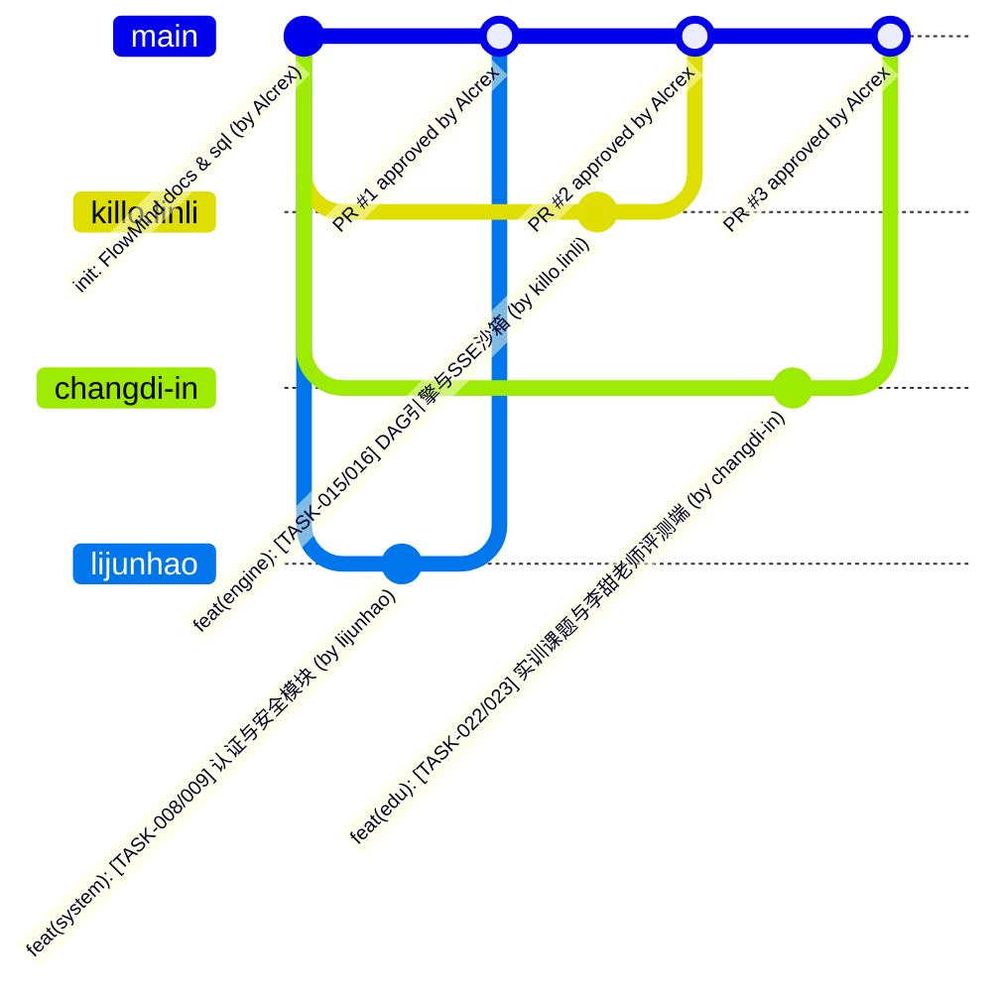

# FlowMind GitHub 团队协作与专属分支强制隔离规范 (GIT_WORKFLOW)

## 1. 团队成员、GitHub 账号与专属分支绑定表

本项目采用 **“一人一专属分支 + 组长统一管控 `main` 主干”** 的严格协作模式。每位组员**仅允许向自己的同名分支推送代码（Push），并通过 Pull Request (PR) 申请合并至 `main`**。

| 姓名 | 系统角色与模块职责 | GitHub 账号 | 强制绑定专属分支 | 允许修改的代码目录范围 |
| :--- | :--- | :--- | :--- | :--- |
| **顾峰鸣** | **项目组长 / 系统管理员 (`admin`)**<br>负责公共底座 (`common`) 与工作流协同 (`workflow`) | `Alcrex` | `main` (主干维护及直接提交) | 全仓库最高权限（重点负责 `common/**`, `workflow/**`, `views/workspace/**`, `views/workflow/**`） |
| **张誉诚** | **组员 1**<br>负责 AI 执行引擎与模板生态 (`engine`) | `killo.linli` | **`killo.linli`**（仅限此分支） | `flowmind-backend/.../engine/**`<br>`flowmind-frontend/src/views/{engine,market}/**`<br>`flowmind-frontend/src/api/engineAndMarketApi.ts`<br>`flowmind-frontend/src/utils/sseClient.ts` |
| **郝唐鑫** | **组员 2**<br>负责高校实训教务与评测统计 (`edu`，指导教师：**李甜**) | `changdi-in` | **`changdi-in`**（仅限此分支） | `flowmind-backend/.../edu/**`<br>`flowmind-frontend/src/views/edu/**`<br>`flowmind-frontend/src/api/eduApi.ts` |
| **李俊豪** | **组员 3**<br>负责认证授权、算力管控与监控大屏 (`system`) | `lijunhao` | **`lijunhao`**（仅限此分支） | `flowmind-backend/.../system/**`<br>`flowmind-frontend/src/views/{auth,error,admin}/**`<br>`flowmind-frontend/src/api/authAndAdminApi.ts` |

---

## 2. 分支流转拓扑图



---

## 3. 如何强制限制组员“只能通过自己的分支提交代码”（三层防线）

仓库已内置自动化门禁配置文件（`.github/workflows/branch-guard.yml` 与 `.github/CODEOWNERS`），配合 GitHub 仓库分支规则集（Rulesets）构成三层强力约束：

### 第一层：GitHub Actions 自动分支与目录门禁 (`.github/workflows/branch-guard.yml`)
每次有成员执行 `git push` 或发起 `Pull Request` 时，GitHub Actions 会自动运行 `Branch & Directory Ownership Guard` 检查：
1. **校验分支归属**：
   - 若操作者 `github.actor == 'killo.linli'`，其推送的目标分支或 PR 的源分支（Head Ref）**必须为 `killo.linli`**，否则直接判定 Check 失败并拒绝合入；
   - 若操作者 `github.actor == 'changdi-in'`，其分支**必须为 `changdi-in`**；
   - 若操作者 `github.actor == 'lijunhao'`，其分支**必须为 `lijunhao`**；
   - 组长 `Alcrex`（顾峰鸣）拥有全分支豁免权。
2. **校验文件越界**：自动比对变更文件列表（`git diff --name-only`），防止组员误改其他成员负责的模块目录。

### 第二层：`.github/CODEOWNERS` 强制组长审批
仓库根目录已配置 `.github/CODEOWNERS`，将全局主干与核心架构的所有权绑定给 `@Alcrex`（顾峰鸣）。任何组员向 `main` 发起的 Pull Request，**必须经过 `@Alcrex` 点击 Approve 审批通过后才允许 Merge**。

### 第三层：GitHub 网页端 1 分钟开启服务端硬拦截（组长顾峰鸣操作指南）
为了让 GitHub 服务器直接拒绝组员 `git push origin main` 或跨分支推送，组长顾峰鸣（`Alcrex`）只需在 GitHub 网页端执行以下 4 步设置：

1. 打开仓库页面 `https://github.com/Alcrex/FlowMind/settings/rules`（**Settings** $\rightarrow$ 左侧 **Rules** $\rightarrow$ **Rulesets**）。
2. 点击 **New ruleset** $\rightarrow$ **New branch ruleset**：
   - **Ruleset Name**：填 `Protect-Main-Branch`
   - **Enforcement status**：切换为 **Active**
   - **Bypass list（豁免名单）**：点击 **Add bypass** $\rightarrow$ 选择 **Repository admin**（即组长顾峰鸣 `Alcrex` 本人可直接推送 `main`，而 Collaborators 组员受限）。
   - **Target branches**：点击 **Add target** $\rightarrow$ 选择 **Include default branch (`main`)**。
3. 在下方 **Branch rules** 勾选以下三项：
   - ✅ **Restrict deletions**（禁止删除主分支）
   - ✅ **Require a pull request before merging** $\rightarrow$ 勾选 **Require review from Code Owners**（强制组长审批 PR，同时徹底禁止组员直接 `git push origin main`）
   - ✅ **Require status checks to pass** $\rightarrow$ 添加 `verify-branch-ownership`（强制通过专属分支检查）
   - ✅ **Block force pushes**（禁止强制覆盖推送）
4. 点击页面底部 **Create** 保存即可立即生效！

---

## 4. 各成员日常 Git 标准操作命令

### 4.1 张誉诚 (`killo.linli`) 标准提交流程
```bash
# 1. 切换到自己的专属分支并同步主干最新代码
git checkout killo.linli
git pull origin main --rebase

# 2. 编写或使用 Codex 完成 engine/market 模块任务后提交
git add .
git commit -m "feat(engine): [TASK-015] 实现Kahn拓扑排序与运行主从表"

# 3. 仅推送到自己的专属分支 killo.linli
git push origin killo.linli
# 随后在 GitHub 网页端发起从 killo.linli -> main 的 Pull Request
```

### 4.2 郝唐鑫 (`changdi-in`) 标准提交流程
```bash
git checkout changdi-in
git pull origin main --rebase
git add .
git commit -m "feat(edu): [TASK-022] 实现实训任务主从表与快照预检"
git push origin changdi-in
# 随后在 GitHub 网页端发起从 changdi-in -> main 的 Pull Request
```

### 4.3 李俊豪 (`lijunhao`) 标准提交流程
```bash
git checkout lijunhao
git pull origin main --rebase
git add .
git commit -m "feat(system): [TASK-008] 实现用户审计表与JWT认证"
git push origin lijunhao
# 随后在 GitHub 网页端发起从 lijunhao -> main 的 Pull Request
```
