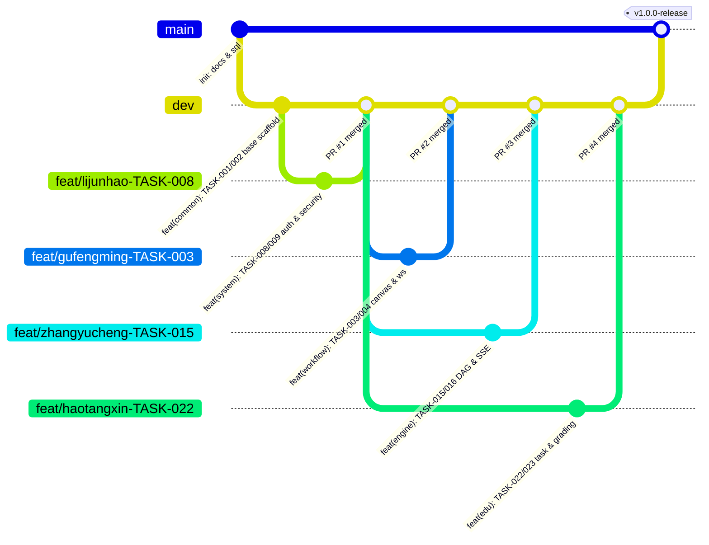

# FlowMind GitHub 团队协作与分支管理规范 (GIT_WORKFLOW)

## 1. 团队成员与 GitHub 协作角色映射

| 姓名 | 项目角色 | 负责模块代号 | GitHub 账号 | 个人开发分支命名规范 |
| :--- | :--- | :--- | :--- | :--- |
| **顾峰鸣** | 项目组长 / 架构师 | `common`, `workflow` | **[待确认]** (Repository Owner) | `feat/gufengming-TASK-xxx` |
| **李俊豪** | 权限安全与大屏负责人 | `system` | `lijunhao` | `feat/lijunhao-TASK-xxx` |
| **张誉诚** | AI引擎与模板生态负责人 | `engine` | `killo.linli` **[待确认]** | `feat/zhangyucheng-TASK-xxx` |
| **郝唐鑫** | 实训教务与评测统计负责人 | `edu` | **[待确认]** | `feat/haotangxin-TASK-xxx` |

> **说明**：目前仓库已邀请 `killo.linli` 与 `lijunhao` 两名成员，其余成员 GitHub 账号及 `killo.linli` 与张誉诚/郝唐鑫的精确对应关系标记为 **[待确认]**，由组长顾峰鸣在 GitHub Collaborators 中最终核对确认。

---

## 2. 分支模型设计 (Git Branching Strategy)

本项目采用轻量级 **GitHub Flow + `dev` 集成分支** 模型，确保 3 周实训周期内高效并行且主干永远可用：



### 2.1 核心分支说明
1. **`main`（受保护生产/答辩分支）**：
   - 严禁任何人直接 `git push origin main`。
   - 仅在第一阶段检查、第二阶段检查及最终答辩里程碑验收通过后，由组长顾峰鸣从 `dev` 发起 Release PR 合入。
2. **`dev`（日常开发集成分支）**：
   - 所有成员（或 Codex 智能体）开发新任务时，必须基于最新的 `dev` 分支切出个人任务分支。
3. **功能任务分支（`feat/<member>-TASK-<id>`）与修复分支（`fix/<member>-TASK-<id>`）**：
   - 示例：`feat/gufengming-TASK-003`、`feat/lijunhao-TASK-009`、`feat/zhangyucheng-TASK-016`、`feat/haotangxin-TASK-022`。
   - 每个分支只聚焦完成 1~2 个紧密关联的 `TASK` 编号，完成后立即提 Pull Request 合入 `dev`。

---

## 3. 文件修改边界与防冲突铁律

为保证 4 人同时使用 Codex 或本地 IDE 开发时不产生合并冲突（Merge Conflict），严格执行以下目录隔离规则：

1. **禁止跨模块修改代码**：
   - 李俊豪仅修改 `backend/.../system/**` 与 `frontend/src/views/{auth,error,admin}/**`、`api/authAndAdminApi.ts`。
   - 顾峰鸣仅修改 `backend/.../workflow/**`、`common/**` 与 `frontend/src/views/{workspace,workflow}/**`、`api/workflowApi.ts`。
   - 张誉诚仅修改 `backend/.../engine/**` 与 `frontend/src/views/{engine,market}/**`、`api/engineAndMarketApi.ts`。
   - 郝唐鑫仅修改 `backend/.../edu/**` 与 `frontend/src/views/edu/**`、`api/eduApi.ts`。
2. **共享文件的唯一维护权**：
   - `sql/init_flowmind.sql`、`flowmind-backend/pom.xml`、`flowmind-frontend/package.json`、`src/router/index.ts` 由组长 **顾峰鸣** 在 `TASK-001` 和 `TASK-005` 中一次性预置好全部 8 张表和 24 条路由。
   - 若组员确需新增依赖或修改路由，必须在 PR 描述中注明，由组长统一合并。

---

## 4. Commit Message 规范 (Conventional Commits)

所有 Git 提交信息必须遵循以下格式：

```text
<type>(<scope>): [TASK-xxx] <简明中文或英文描述>
```

- **允许的 `<type>`**：
  - `feat`：新增功能或视图（如 `feat(workflow): [TASK-003] 实现工作流主从表CRUD与多条件查询`）
  - `fix`：修复 Bug（如 `fix(engine): [TASK-016] 修复CONDITION节点false分支剪枝状态更新问题`）
  - `docs`：仅文档更新
  - `test`：新增或修改单元测试/集成测试
  - `refactor`：不影响外部接口的代码重构
- **允许的 `<scope>`**：`common`、`system`、`workflow`、`engine`、`edu`、`frontend`、`sql`、`docs`。

---

## 5. Pull Request (PR) 与 Code Review 合并规则

### 5.1 提交 PR 前的自检清单（Codex 与成员必做）
在发起 PR 到 `dev` 分支前，必须在本地终端依次执行并确保 100% 通过：
```bash
# 1. 拉取最新 dev 分支并变基/合并
git fetch origin dev
git rebase origin/dev

# 2. 若涉及后端修改，运行编译与测试
cd flowmind-backend && mvn clean test

# 3. 若涉及前端修改，运行类型检查与构建测试
cd flowmind-frontend && npm run build
```

### 5.2 PR 模板格式
每个 PR 描述必须包含：
1. **关联任务编号**：如 `Closes TASK-008, TASK-009`
2. **本次修改文件清单**：列出新增/修改的后端类与前端 `.vue` 视图文件
3. **接口与数据库一致性核对**：确认未偏离 `docs/DATABASE.md` 与 `docs/API.md`
4. **本地测试结果截图或日志摘要**

### 5.3 Code Review 审批机制
- 组员发起的 PR 由组长 **顾峰鸣** 进行 Code Review，重点核查是否误改他人目录、是否遗漏 `@RestControllerAdvice` 异常兼容、是否包含硬编码密钥。
- 组长发起的 PR 由任意一名组员（`lijunhao` 或 `killo.linli`）Review 后合入。
